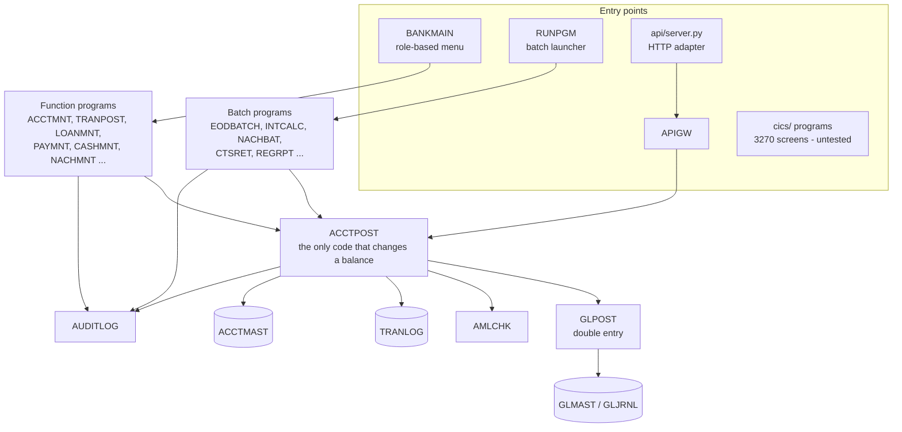
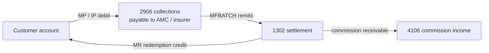
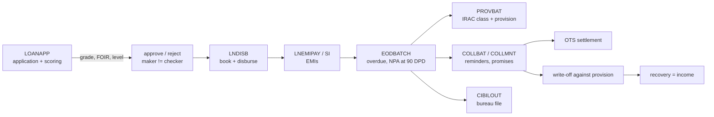

# Architecture

CoreBank is a teaching-scale core banking system written in COBOL (GnuCOBOL
3.x, fixed format). It is organised the way mainframe banking systems
usually are: a thin online layer, a set of shared posting services, indexed
master files, an append-only transaction journal, a double-entry general
ledger, and a night of batch jobs that reconcile everything.

See also: [PROGRAMS.md](PROGRAMS.md) (every program, generated) and
[DATA_DICTIONARY.md](DATA_DICTIONARY.md) (every record layout, generated).

## Layers

## Rules the design enforces

1. **One posting path.** Every debit or credit of a customer account goes
   through `ACCTPOST`, whoever calls it (teller screen, ATM, standing
   instruction, NACH file, API, interest batch). Balance, minimum-balance,
   overdraft, dormancy and frozen-account rules therefore live in one place.
   `TXNEXEC` sits on top of it for teller cash/transfer so the direct path
   and the maker-checker approval path behave identically.
2. **Every posting is a journal entry.** `ACCTPOST` writes the transaction
   log and calls `GLPOST` with the right contra GL for the transaction type
   (cash, clearing, NACH settlement, card receivables ...). `GLRPT`
   reconciles each sub-ledger (accounts, loans, deposits, cards, gold
   loans) against its control GL every night; a difference abends the job.
3. **Batch is restartable.** Each batch step is safe to run twice (products
   keyed on the last product date, interest on the last interest month,
   charges on code + period, cheques on paid leaves). On top of that,
   `CHKPOINT` gives programs commit points so a crashed EOD resumes where it
   stopped, and `jobs/common.sh` (or `RESTART=` in JCL) skips finished
   steps.
4. **Four eyes on big money.** A teller can post up to 2,00,000; above that
   the item waits in `PENDTXN` until a different user with approval rights
   accepts it (`APPRVMNT`). Undecided items expire at EOD.
5. **Everything is audited.** Sign-ons, refusals, rate changes, approvals,
   batch start/end and every master change go to `AUDITLOG`.
6. **Rates are versioned, not overwritten.** A new deposit rate card is a
   new set of rows with an effective date (`FDRATE`); a deposit stores the
   rate it was booked at, and premature closure looks up the card that was
   in force on the booking day. Cards in force can never be edited.
7. **Batch speed without breaking online.** Big posting loops switch the
   posting chain into keep-files-open mode with `BATCHCTL` (an EXTERNAL
   byte read by ACCTPOST, GLPOST, AUDITLOG and AMLCHK). Online programs
   never set it, so they keep opening and closing per call.

## Files

Indexed (VSAM KSDS on a mainframe): accounts, customers, holders/nominees,
loans, deposits, debit cards, credit cards, cheque register, charges log,
GL, lockers, payments, standing instructions, users, AML day tallies, rate
master, maker-checker queue, cash positions, NACH mandates, outward cheques,
checkpoints. Sequential: transaction log, audit trail, GL journal, card
transactions, TDS log. Interface files (NACH in/out, CTS out/returns, CIBIL,
26AS) are fixed-width line-sequential, with layouts in each program header.

## Daily cycle

```mermaid
graph LR
    A[Control totals] --> B[Inward clearing]
    B --> C[Payments settlement]
    C --> D[NACH debits]
    D --> E[CTS returns + credits]
    E --> F[CTS presentation]
    F --> G[Standing instructions]
    G --> SW[Auto-sweep]
    SW --> H[EOD: products, dormancy,<br/>loans, deposits, cards]
    H --> I[Repo-linked reset]
    I --> J[Card batch]
    J --> K[Gold revaluation]
    K --> L[Branch cash]
    K --> MF[SIPs, premiums,<br/>AMC remittance]
    MF --> K2[Trade finance expiry]
    K2 --> L
    L --> M[Master vs log recon]
    M --> N[GL + sub-ledger recon]
    N --> F2[Fraud rules]
    F2 --> C2[Collections reminders]
    C2 --> ST[Stock reorder]
    ST --> CM[Complaint escalation]
    CM --> IB[Inter-branch recon]
    IB --> O[MIS]
```

Month end adds interest, charges, AML (CTR/STR), TDS certificates, CSV
extract, the credit bureau file, the regulatory returns, IRAC provisioning
and accrual, customer statements and the audit exception report. Once a
year, after the 31 March cycle, `jobs/YEAREND.sh` closes income and expense
into the P&L account and appropriates the result to the reserves.

## Money that goes to third parties

## The life of a loan

## Around the core

| Directory | What | Tested here? |
|---|---|---|
| `api/` | JSON gateway (APIGW in COBOL) + stdlib HTTP adapter | yes |
| `sql/` | Nightly load into PostgreSQL + cursor reports (OCESQL) | yes, when PostgreSQL is present |
| `jcl/` | IDCAMS definitions, PROC, EOD / month-end / CICS file jobs | no - no z/OS |
| `cics/` | BMS maps + pseudo-conversational programs | syntax only (`cics/check.sh`) |
| `tests/` | end-to-end suite (`run_tests.sh`) and COBOL unit tests (`unit/`) | yes |

## Known simplifications

* Single currency (INR), single bank code (`CBNK`). The GL has no branch
  dimension; branch positions and inter-branch accounts are derived by
  `BRGLBAT` from the sub-ledgers and the transfer legs.
* Password hashing is a salted polynomial hash - fine for learning, not for
  production (a real system delegates to RACF/LDAP; the CICS sign-on does).
* Regulatory returns are simplified management versions, not RBI formats.
* Indexed files are not shared between concurrent writers; the API adapter
  serialises requests for that reason.
