# Program catalogue

Generated by `tools/callgraph.py` from the sources - do not edit by hand.

97 programs. The menu (BANKMAIN) and the batch launcher
(RUNPGM) are the only executables; everything else is a callable module.

## Main call paths

```mermaid
graph LR
    ACCTMNT --> AMLCHK
    ACCTMNT --> AUDITLOG
    ACCTMNT --> GLPOST
    ACCTPOST --> AMLCHK
    ACCTPOST --> AUDITLOG
    ACCTPOST --> GLPOST
    APIGW --> ACCTPOST
    APIGW --> AUDITLOG
    APPRVMNT --> AUDITLOG
    APPRVMNT --> TXNEXEC
    ATMTXN --> ACCTPOST
    BANKMAIN --> ACCTMNT
    BANKMAIN --> ACCTSCR
    BANKMAIN --> AMLRPT
    BANKMAIN --> APPRVMNT
    BANKMAIN --> ATMTXN
    BANKMAIN --> AUDITLOG
    BANKMAIN --> CARDMNT
    BANKMAIN --> CASHMNT
    BANKMAIN --> CCBATCH
    BANKMAIN --> CCMNT
    BANKMAIN --> CHGBATCH
    BANKMAIN --> CHQMNT
    BANKMAIN --> CUSTMNT
    BANKMAIN --> DATAUTIL
    BANKMAIN --> DEPMNT
    BANKMAIN --> EODBATCH
    BANKMAIN --> GLRPT
    BANKMAIN --> GOLDREVL
    BANKMAIN --> HLDMNT
    BANKMAIN --> INTCALC
    BANKMAIN --> LOANMNT
    BANKMAIN --> LOCKMNT
    BANKMAIN --> MISRPT
    BANKMAIN --> MKRQUEUE
    BANKMAIN --> MOREMENU
    BANKMAIN --> NACHMNT
    BANKMAIN --> PAYBATCH
    BANKMAIN --> PAYMNT
    BANKMAIN --> RATEMNT
    BANKMAIN --> SECLOAN
    BANKMAIN --> SIBATCH
    BANKMAIN --> SIGNON
    BANKMAIN --> SIMNT
    BANKMAIN --> STMTRPT
    BANKMAIN --> TDSRPT
    BANKMAIN --> TRANPOST
    BANKMAIN --> USERMNT
    BATCHCTL --> ACCTPOST
    BATCHCTL --> AMLCHK
    BATCHCTL --> AUDITLOG
    BATCHCTL --> GLPOST
    BRMNT --> AUDITLOG
    CARDMNT --> ACCTPOST
    CASHMNT --> AUDITLOG
    CASHMNT --> GLPOST
    CCBATCH --> ACCTPOST
    CCMNT --> ACCTPOST
    CCMNT --> AUDITLOG
    CCPOST --> GLPOST
    CHGBATCH --> ACCTPOST
    CHGBATCH --> GLPOST
    CHQMNT --> ACCTPOST
    CHQMNT --> AUDITLOG
    CLRBATCH --> ACCTPOST
    CLRBATCH --> GLPOST
    CMPMNT --> ACCTPOST
    CMPMNT --> AUDITLOG
    COLLMNT --> ACCTPOST
    COLLMNT --> AUDITLOG
    COLLMNT --> GLPOST
    CTSMNT --> ACCTPOST
    CTSMNT --> AUDITLOG
    CTSRET --> ACCTPOST
    CTSRET --> GLPOST
    CUSTMNT --> ACCTPOST
    CUSTMNT --> AUDITLOG
    DATAUTIL --> GLPOST
    DEPMNT --> ACCTPOST
    DEPPAY --> ACCTPOST
    DEPPAY --> GLPOST
    FDRTMNT --> AUDITLOG
    FRAUDMNT --> AUDITLOG
    FXMNT --> ACCTPOST
    FXMNT --> AUDITLOG
    FXMNT --> GLPOST
    HLDMNT --> ACCTPOST
    HLDMNT --> AUDITLOG
    INTCALC --> GLPOST
    INVMNT --> AUDITLOG
    LNDISB --> ACCTPOST
    LNEMIPAY --> ACCTPOST
    LNEMIPAY --> GLPOST
    LNRESET --> AUDITLOG
    LOANAPP --> ACCTPOST
    LOANAPP --> AUDITLOG
    LOANMNT --> ACCTPOST
    LOCKMNT --> ACCTPOST
    LOCKMNT --> AUDITLOG
    LOCKMNT --> GLPOST
    MFBATCH --> GLPOST
    MFMNT --> AUDITLOG
    MFUTIL --> ACCTPOST
    MFUTIL --> GLPOST
    MKRQUEUE --> AUDITLOG
    NACHBAT --> ACCTPOST
    NACHBAT --> AUDITLOG
    NACHBAT --> GLPOST
    NACHMNT --> ACCTPOST
    NACHMNT --> AUDITLOG
    PAYBATCH --> ACCTPOST
    PAYMNT --> ACCTPOST
    PAYMNT --> AUDITLOG
    PAYMNT --> GLPOST
    PROVBAT --> GLPOST
    RATEMNT --> AUDITLOG
    RUNPGM --> AUDITLOG
    SECLOAN --> ACCTPOST
    SECLOAN --> AUDITLOG
    SIBATCH --> ACCTPOST
    SIBATCH --> GLPOST
    SIGNON --> AUDITLOG
    SIMNT --> ACCTPOST
    SIMNT --> AUDITLOG
    STMTREQ --> ACCTPOST
    SWEEPBAT --> ACCTPOST
    SWEEPMNT --> AUDITLOG
    TESTGEN --> ACCTPOST
    TESTGEN --> GLPOST
    TFBATCH --> ACCTPOST
    TFBATCH --> AUDITLOG
    TFMNT --> ACCTPOST
    TFMNT --> AUDITLOG
    TFMNT --> GLPOST
    TRANPOST --> TXNEXEC
    TXNEXEC --> ACCTPOST
    TXNEXEC --> CASHUTIL
    USERMNT --> AUDITLOG
    YREND --> AUDITLOG
    YREND --> GLPOST
```

## Programs

| Program | Purpose | Files | Calls | Called by |
|---|---|---|---|---|
| ACCTMNT | Account maintenance - open, inquire, update contact details, freeze/unfreeze and close | ACCTMAST, TRANLOG | AMLCHK, AUDITLOG, GLPOST | BANKMAIN |
| ACCTPOST | Common account posting routine | ACCTMAST, TRANLOG | AMLCHK, AUDITLOG, GLPOST | APIGW, ATMTXN, BATCHCTL, CARDMNT, CCBATCH, CCMNT, CHGBATCH, CHQMNT, CLRBATCH, CMPMNT, COLLMNT, CTSMNT, CTSRET, CUSTMNT, DEPMNT, DEPPAY, FXMNT, HLDMNT, LNDISB, LNEMIPAY, LOANAPP, LOANMNT, LOCKMNT, MFUTIL, NACHBAT, NACHMNT, PAYBATCH, PAYMNT, SECLOAN, SIBATCH, SIMNT, STMTREQ, SWEEPBAT, TESTGEN, TFBATCH, TFMNT, TXNEXEC |
| ACCTSCR | Customer 360 screen - a full-screen, form-based view of one account built with the screen section (the gnucobol equivalent of a CICS bms map) | ACCTMAST, CARDMAST, DEPMAST, LOANMAST, TRANLOG | - | BANKMAIN |
| AMLCHK | Anti-money-laundering screen, called by ACCTPOST after every posting | AMLALERT, AMLDAY | - | ACCTMNT, ACCTPOST, BATCHCTL |
| AMLRPT | Monthly AML report | AMLALERT | - | BANKMAIN, RUNPGM |
| APIGW | JSON API gateway - the cobol side of the mobile / net banking API (the role z/os connect plays on a mainframe) | APIKEYS, TRANLOG | ACCTPOST, AUDITLOG | RUNPGM |
| APPRVMNT | Checker screen for the maker-checker queue | PENDTXN | AUDITLOG, TXNEXEC | BANKMAIN |
| ATMTXN | ATM session simulator - card + PIN authentication, cash withdrawal, balance enquiry, mini statement | CARDMAST, TRANLOG | ACCTPOST, CARDUTIL | BANKMAIN |
| AUDEXRPT | Exception report for internal audit / RBI inspection, built from the audit trail for a date range | AUDITLOG | - | RUNPGM |
| AUDITLOG | Appends one line to the audit trail | AUDITLOG | - | ACCTMNT, ACCTPOST, APIGW, APPRVMNT, BANKMAIN, BATCHCTL, BRMNT, CASHMNT, CCMNT, CHQMNT, CMPMNT, COLLMNT, CTSMNT, CUSTMNT, FDRTMNT, FRAUDMNT, FXMNT, HLDMNT, INVMNT, LNRESET, LOANAPP, LOCKMNT, MFMNT, MKRQUEUE, NACHBAT, NACHMNT, PAYMNT, RATEMNT, RUNPGM, SECLOAN, SIGNON, SIMNT, SWEEPMNT, TFBATCH, TFMNT, USERMNT, YREND |
| BANKMAIN | Main menu / driver for the core banking system | - | ACCTMNT, ACCTSCR, AMLRPT, APPRVMNT, ATMTXN, AUDITLOG, CARDMNT, CASHMNT, CCBATCH, CCMNT, CHGBATCH, CHQMNT, CUSTMNT, DATAUTIL, DEPMNT, EODBATCH, GLRPT, GOLDREVL, HLDMNT, INTCALC, LOANMNT, LOCKMNT, MISRPT, MKRQUEUE, MOREMENU, NACHMNT, PAYBATCH, PAYMNT, RATEMNT, SECLOAN, SIBATCH, SIGNON, SIMNT, STMTRPT, TDSRPT, TRANPOST, USERMNT | - |
| BATCHCTL | Switches the posting chain into / out of batch "keep files open" mode | - | ACCTPOST, AMLCHK, AUDITLOG, GLPOST | SWEEPBAT, TESTGEN |
| BRGLBAT | Branch accounting for one business day | ACCTMAST, BRGLSORT.TMP, BRMAST, DEPMAST, LOANMAST, TRANLOG | - | RUNPGM |
| BRMNT | Branch master maintenance (admin) | ACCTMAST, BRMAST | AUDITLOG | MOREMENU |
| CARDMNT | Debit card maintenance (branch side) - issue card, inquiry, PIN change, hotlist, unlock after wrong PIN attempts and daily limit change | CARDMAST | ACCTPOST, CARDUTIL, INVUTIL | BANKMAIN |
| CARDUTIL | Card helper routines | - | - | ATMTXN, CARDMNT, CCMNT |
| CASHMNT | Branch cash management | CASHPOS | AUDITLOG, GLPOST | BANKMAIN |
| CASHRPT | End-of-day cash position for every branch | CASHPOS, GLMAST | - | RUNPGM |
| CASHUTIL | Keeps a teller's drawer in step with the cash he takes in and pays out | CASHPOS | - | TXNEXEC |
| CCBATCH | Credit card billing | CCMAST, CCTXN | ACCTPOST, CCPOST, DATEUTIL | BANKMAIN, RUNPGM |
| CCMNT | Credit cards - online | CCMAST, CCTXN, CUSTMAST | ACCTPOST, AUDITLOG, CARDUTIL, CCPOST, DATEUTIL | BANKMAIN |
| CCPOST | Applies one credit card transaction to a card record in the caller's buffer, logs it to cctxn and posts the GL entry | CCTXN | GLPOST | CCBATCH, CCMNT |
| CHGBATCH | Periodic service charges with 18% GST | ACCTMAST, CARDMAST, CHGLKR.TMP, CHGLOG, CHGWORK.TMP, LOCKMAST | ACCTPOST, DATEUTIL, GLPOST | BANKMAIN, RUNPGM |
| CHKPOINT | Checkpoint / restart service for long batch runs | CHKPOINT | - | EODBATCH |
| CHQMNT | Cheque services (branch side) - issue cheque book, leaf status inquiry, stop payment, revoke stop, list leaves of an account, and (manager) run the inward clearing batch | CHQREG | ACCTPOST, AUDITLOG, CLRBATCH, CTSMNT, INVUTIL | BANKMAIN |
| CIBILOUT | Monthly credit bureau submission | LOANMAST | CUSTLKUP, DATEUTIL | RUNPGM |
| CLRBATCH | Inward cheque clearing | CHQREG, CLRIN | ACCTPOST, DATEUTIL, GLPOST | CHQMNT, RUNPGM |
| CMPBATCH | Daily complaint sla run and monthly return | CMPMAST | DATEUTIL | RUNPGM |
| CMPMNT | Customer complaints and service requests | CMPMAST | ACCTPOST, AUDITLOG, CUSTLKUP, DATEUTIL | MOREMENU |
| COLLBAT | Daily collections run 1 | COLLLOG, LOANMAST | CUSTLKUP, DATEUTIL | RUNPGM |
| COLLMNT | Collections and recovery on overdue loans | COLLLOG, LOANMAST | ACCTPOST, AUDITLOG, DATEUTIL, GLPOST | LOANMNT |
| CTSMNT | Outward cheques (CTS) at the counter | OUTCHQ | ACCTPOST, AUDITLOG, DATEUTIL | CHQMNT |
| CTSOUT | Builds the outward CTS presentation file: every cheque lodged at the counters and not yet sent goes into one batch for the clearing house and is marked 'in clearing' | OUTCHQ | - | RUNPGM |
| CTSRET | Outward CTS results | CTSRESP, OUTCHQ | ACCTPOST, GLPOST | RUNPGM |
| CUSTLKUP | Finds the primary holder (acctrel seq 01) of an account and returns his KYC data from custmast | ACCTREL, CUSTMAST | - | CIBILOUT, CMPMNT, COLLBAT, LOANAPP, MFMNT, STMTBAT, STMTREQ, TDS26AS |
| CUSTMNT | Customer information file (CIF) and KYC | CUSTMAST | ACCTPOST, AUDITLOG, DATEUTIL | BANKMAIN |
| DATAUTIL | Data utilities (admin / batch) | ACCTEXP.CSV, ACCTIMP.CSV, ACCTMAST, ACCTREJ.CSV, SORTWK2.TMP, TRANLOG | GLPOST | BANKMAIN, RUNPGM |
| DATEUTIL | Date arithmetic used by loans, deposits and EOD | - | - | CCBATCH, CCMNT, CHGBATCH, CIBILOUT, CLRBATCH, CMPBATCH, CMPMNT, COLLBAT, COLLMNT, CTSMNT, CUSTMNT, DEPMNT, EODBATCH, FRAUDBAT, HLDMNT, INTCALC, LNDISB, LNEMIPAY, LOANAPP, LOANMNT, LOCKMNT, MFBATCH, MFMNT, MFUTIL, MISRPT, NACHMNT, PAYBATCH, PROVBAT, REGRPT, SECLOAN, SIBATCH, SIGNON, SIMNT, STMTBAT, STMTREQ, SWEEPBAT, TESTGEN, TFBATCH, TFMNT |
| DEPCALC | Term deposit calculations shared by DEPMNT and the end-of-day batch - rate card lookup, FD value and RD value with quarterly compounding | FDRATE | - | DEPMNT, EODBATCH, FDRTMNT, SWEEPBAT |
| DEPMNT | Term deposits - open FD / RD funded from a savings or current account, RD instalment payment, inquiry, premature closure and list by account | DEPMAST | ACCTPOST, DATEUTIL, DEPCALC, DEPPAY | BANKMAIN |
| DEPPAY | Term deposit payout with tax deducted at source | TDSLOG | ACCTPOST, GLPOST | DEPMNT, EODBATCH, SWEEPBAT |
| EODBATCH | End-of-day batch | ACCTMAST, CARDMAST, DEPMAST, LOANMAST, TRANLOG | CHKPOINT, DATEUTIL, DEPCALC, DEPPAY, MKRQUEUE | BANKMAIN, RUNPGM |
| FDRTMNT | Term deposit rate card maintenance with versions | FDRATE | AUDITLOG, DEPCALC | MOREMENU |
| FRAUDBAT | Fraud monitoring - scans one day of the transaction log against behaviour rules and raises alerts for review (FRAUDMNT) | FRAUDALT, TRANLOG | DATEUTIL | RUNPGM |
| FRAUDMNT | Fraud alert review (manager) | ACCTMAST, FRAUDALT | AUDITLOG | MOREMENU |
| FXMNT | Foreign exchange and nri remittances | ACCTMAST, FXLOG, FXRATE | ACCTPOST, AUDITLOG, GLPOST | MOREMENU |
| GLPOST | Posts one balanced journal entry (debit GL x, credit GL y) to the general ledger and appends both legs to the GL journal | GLJRNL, GLMAST | - | ACCTMNT, ACCTPOST, BATCHCTL, CASHMNT, CCPOST, CHGBATCH, CLRBATCH, COLLMNT, CTSRET, DATAUTIL, DEPPAY, FXMNT, INTCALC, LNEMIPAY, LOCKMNT, MFBATCH, MFUTIL, NACHBAT, PAYMNT, PROVBAT, SIBATCH, TESTGEN, TFMNT, YREND |
| GLRPT | General ledger reports | ACCTMAST, CCMAST, DEPMAST, GLMAST, LOANMAST | - | BANKMAIN, RUNPGM |
| GOLDREVL | Gold loan revaluation | GOLDRATE, LOANMAST | - | BANKMAIN, RUNPGM |
| HLDMNT | Account holders and nominee | ACCTREL, CUSTMAST | ACCTPOST, AUDITLOG, DATEUTIL | BANKMAIN |
| INTCALC | Monthly interest batch, on daily products | ACCTMAST, TRANLOG | DATEUTIL, GLPOST | BANKMAIN, RUNPGM, RUNPGM |
| INVBATCH | End-of-day stock check for every branch and item | INVLOG, INVSTOCK | - | RUNPGM |
| INVMNT | Branch stock register for cheque books and card blanks (security stationery) | INVLOG, INVSTOCK | AUDITLOG | MOREMENU |
| INVUTIL | Issues stock at a branch (cheque book, card blank) and logs the movement | INVLOG, INVSTOCK | - | CARDMNT, CHQMNT |
| LNDISB | Books and disburses a term loan: allocates the next loan number, credits the linked account (ACCTPOST, type ld, which also posts dr 1201 loans) and writes the loan master with the first EMI due in one month | LOANMAST | ACCTPOST, DATEUTIL | LOANAPP, LOANMNT |
| LNEMIPAY | Loan repayment engine, shared by the loan screen (LOANMNT) and standing instructions (SIBATCH) | - | ACCTPOST, DATEUTIL, GLPOST | LOANMNT, SIBATCH |
| LNRESET | Resets every active repo-linked loan to the current repo rate + its own spread (spread is fixed at disbursal, only the benchmark moves) | LOANMAST | AUDITLOG, RATEUTIL | RATEMNT, RUNPGM |
| LOANAPP | Loan origination - application to disbursal | LOANAPP | ACCTPOST, AUDITLOG, CUSTLKUP, DATEUTIL, LNDISB, RATEUTIL | LOANMNT |
| LOANMNT | Loan management - sanction and disburse a loan to a linked savings/current account, loan inquiry, amortisation schedule, EMI payment and foreclosure | LOANMAST | ACCTPOST, COLLMNT, DATEUTIL, LNDISB, LNEMIPAY, LOANAPP, RATEUTIL | BANKMAIN |
| LOCKMNT | Safe deposit lockers | CUSTMAST, LOCKMAST, LOCKVISIT | ACCTPOST, AUDITLOG, DATEUTIL, GLPOST | BANKMAIN |
| MFBATCH | End-of-day run for third-party products | GLMAST, MFHOLD, MFSCHEME, MFSIP | DATEUTIL, GLPOST, MFUTIL | RUNPGM |
| MFMNT | Third-party product distribution at the counter - mutual funds and insurance | MFHOLD, MFSCHEME, MFSIP | AUDITLOG, CUSTLKUP, DATEUTIL, MFUTIL | MOREMENU |
| MFUTIL | Money side of third-party products, shared by MFMNT (counter) and MFBATCH (sip / premium run) | MFHOLD, MFSCHEME, MFTXN | ACCTPOST, DATEUTIL, GLPOST | MFBATCH, MFMNT |
| MISRPT | Management information reports | ACCTMAST, DEPMAST, LOANMAST, SORTWK.TMP | DATEUTIL | BANKMAIN, RUNPGM |
| MKRQUEUE | Writes to (or counts) the maker-checker queue | PENDTXN | AUDITLOG | BANKMAIN, EODBATCH, TRANPOST |
| MOREMENU | Second menu page (main menu option 0) - the main menu has used up its single-key options | - | BRMNT, CMPMNT, FDRTMNT, FRAUDMNT, FXMNT, INVMNT, MFMNT, STMTREQ, SWEEPMNT, TFMNT | BANKMAIN |
| NACHBAT | Processes the inward NACH debit file from the clearing house (data/nachin.dat) | MANDMAST, NACHIN | ACCTPOST, AUDITLOG, GLPOST | RUNPGM |
| NACHMNT | NACH debit mandates | MANDMAST | ACCTPOST, AUDITLOG, DATEUTIL | BANKMAIN |
| PAYBATCH | Payment settlement batch, three steps | PAYIN, PAYREG, PAYRET | ACCTPOST, DATEUTIL | BANKMAIN, RUNPGM |
| PAYMNT | Outward payments at the branch - NEFT, RTGS, IMPS and UPI - plus status inquiry and a payment list | PAYREG | ACCTPOST, AUDITLOG, GLPOST | BANKMAIN |
| PROVBAT | RBI irac norms - asset classification, provisioning and interest accrual for the loan book | GLMAST, LOANMAST | DATEUTIL, GLPOST | RUNPGM |
| RATEMNT | Interest rate master maintenance (manager) | RATEHIST, RATEMAST | AUDITLOG, LNRESET | BANKMAIN |
| RATEUTIL | Look up one rate in the rate master | RATEMAST | - | LNRESET, LOANAPP, LOANMNT, REGRPT |
| REGRPT | Regulatory returns (simplified, for management use) | ACCTMAST, DEPMAST, GLMAST, LOANMAST | DATEUTIL, RATEUTIL | RUNPGM |
| RUNPGM | Batch launcher - the "exec pgm=" of this system | - | AUDITLOG, INTCALC | - |
| SECLOAN | Secured loans | DEPMAST, GOLDRATE, LOANMAST | ACCTPOST, AUDITLOG, DATEUTIL | BANKMAIN |
| SECUTIL | Password hashing and password policy check | - | - | SIGNON, USERMNT |
| SIBATCH | Executes standing instructions due on or before the run date | DEPMAST, LOANMAST, SIMAST | ACCTPOST, DATEUTIL, GLPOST, LNEMIPAY | BANKMAIN, RUNPGM |
| SIGNON | User SIGN-ON for the online system | USERMAST | AUDITLOG, DATEUTIL, SECUTIL | BANKMAIN |
| SIMNT | Standing instructions - set up a monthly transfer, loan EMI debit or RD instalment debit, inquire, suspend / resume, cancel, list | DEPMAST, LOANMAST, SIMAST | ACCTPOST, AUDITLOG, DATEUTIL | BANKMAIN |
| SQLINQ | Account enquiry against the SQL reporting database (the db2-style copy loaded by SQLLOAD), showing parameterised embedded SQL | - | - | RUNPGM |
| SQLLOAD | Nightly copy of the indexed masters into POSTGRESQL (the "VSAM to DB2" feed) | ACCTMAST, CUSTMAST, DEPMAST, GLMAST, LOANMAST, TRANLOG | - | RUNPGM |
| SQLRPT | Management reports run against the POSTGRESQL copy loaded by SQLLOAD, using embedded SQL cursors | - | - | RUNPGM |
| STMTBAT | Customer statements 1 | ACCTMAST, MAILQ, PRINTQ, SORTWK4.TMP, STMTREQ, TRANLOG | CUSTLKUP, DATEUTIL | RUNPGM |
| STMTREQ | Takes a customer's request for a statement for any period (up to one year, not in the future) and queues it for the next STMTBAT run | STMTREQ | ACCTPOST, CUSTLKUP, DATEUTIL | MOREMENU |
| STMTRPT | Account statement for a date range | ACCTMAST, TRANLOG | - | BANKMAIN |
| SWEEPBAT | End-of-day auto-sweep for every active mandate | DEPMAST, SWPMAST | ACCTPOST, BATCHCTL, DATEUTIL, DEPCALC, DEPPAY | RUNPGM |
| SWEEPMNT | Auto-sweep mandates and overdraft against FD | ACCTMAST, DEPMAST, SWPMAST | AUDITLOG | MOREMENU |
| TDS26AS | Reconciles the TDS the bank deducted (tdslog) with what the income tax department shows against the bank's tan (the form 26as / traces extract, data/f26as.dat) | F26AS, TDSLOG | CUSTLKUP | RUNPGM |
| TDSRPT | TDS certificates (form 16a style) for one financial year - one block per account listing every deposit payout with interest, TDS and net, plus a bank-wide total that should equal the TDS payable GL (2502) | SORTWK3.TMP, TDSLOG | - | BANKMAIN, RUNPGM |
| TESTGEN | Test data generator | ACCTMAST, LOANMAST, TRANLOG | ACCTPOST, BATCHCTL, DATEUTIL, GLPOST | RUNPGM |
| TFBATCH | Daily trade finance run 1 | TFMAST | ACCTPOST, AUDITLOG, DATEUTIL | RUNPGM |
| TFMNT | Trade finance - bank guarantees and letters of credit | TFMAST | ACCTPOST, AUDITLOG, DATEUTIL, GLPOST | MOREMENU |
| TRANPOST | Online transaction posting - cash deposit, cash withdrawal and internal fund transfer | - | MKRQUEUE, TXNEXEC | BANKMAIN |
| TXNEXEC | Executes one teller transaction - cash deposit, cash withdrawal or internal transfer - through ACCTPOST | - | ACCTPOST, CASHUTIL | APPRVMNT, TRANPOST |
| USERMNT | User administration and password change | AUDITLOG, USERMAST | AUDITLOG, SECUTIL | BANKMAIN |
| YREND | Financial year-end closing (year ends 31 march) | GLMAST, YRENDLOG | AUDITLOG, GLPOST | RUNPGM |
